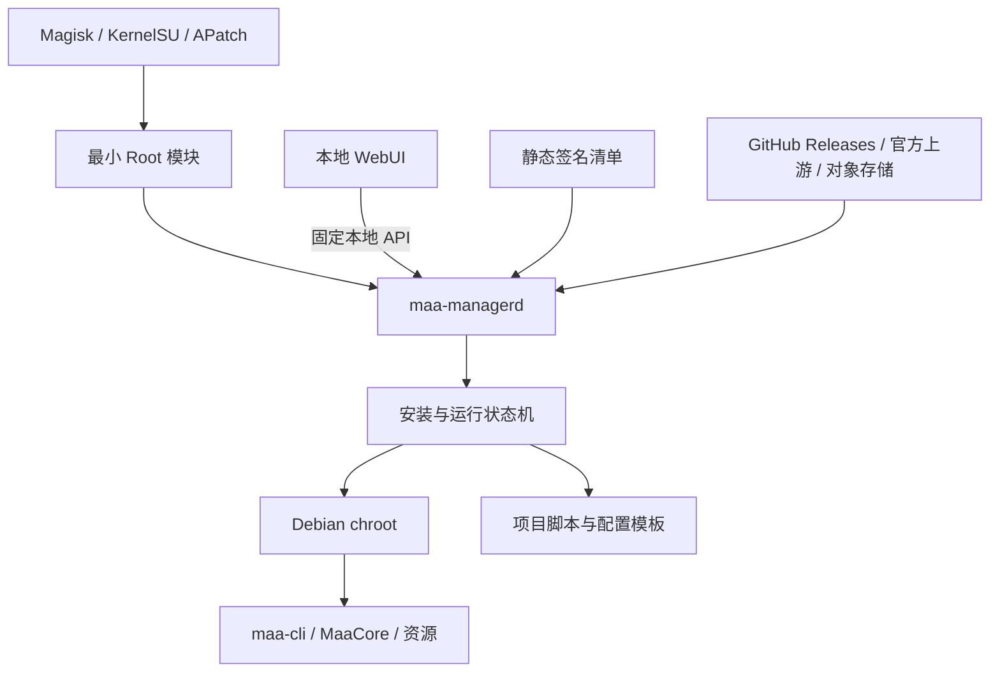

# 总体架构

## 设计结论

采用“Root 管理器模块 + 常驻后台管理程序 + 本地 WebUI + 第三方文件托管”的结构。Root 模块是最小可信引导层；后台程序是唯一控制面；Debian、maa-cli、MaaCore、资源和项目脚本是可替换的数据面组件。



## 组件职责

### Root 管理器模块

只承担以下稳定职责：

- 安装设备适配层和 `maa-managerd` 救援版本。
- 通过非阻塞开机脚本启动后台程序。
- 提供“打开管理页面”“查看救援状态”“停用服务”入口。
- 后台程序或项目包损坏时，仍能启动上一版或恢复模式。
- 模块卸载时默认停用服务，但不静默删除用户数据。

模块目录不保存 Debian rootfs、MaaCore 资源或用户配置。Root 管理器升级和模块重装不能成为数据丢失点。

### `maa-managerd`

后台程序是唯一编排者：

- 识别 CPU、Android API、Root 管理器、空间、网络和必要内核能力。
- 获取并验证签名清单。
- 下载、断点续传、校验和解压组件。
- 维护 `current` / `previous` 版本指针。
- 启停 Debian chroot 和 MAA 任务。
- 统一管理任务锁、计划、进度、日志和诊断导出。
- 调用上游官方更新机制，但先执行兼容策略和空闲检查。
- 为 WebUI 提供结构化状态，不把原始 shell 输出当作产品协议。

第一阶段不重写现有 MAA 业务逻辑。后台程序通过固定适配器调用现有脚本，逐步收拢重复的更新、定时和状态判断职责。

### WebUI

WebUI 只负责：

- 首次安装向导。
- 状态、进度、版本、任务计划和简化日志展示。
- 向后台提交结构化操作请求。
- 展示需要用户确认的风险、下载大小和回滚结果。

WebUI 不接受任意命令或任意下载 URL，不直接写系统目录，也不自行判断安装是否成功。

### 运行组件

运行组件至少拆成：

- `manager`：后台程序及内置恢复页面。
- `project`：本项目脚本、WebUI静态资源和默认配置模板。
- `debian-rootfs`：Debian基础环境。
- `maa-cli`：官方 CLI。
- `maacore`：MaaCore。
- `maa-resource`：游戏资源。

组件独立版本化，避免仅更新资源也必须重新刷 Root 模块。

## 设备目录

```text
/data/adb/modules/maa-phone-manager/    Root 模块与启动/救援入口
/data/local/maa-platform/
├── manager/                            后台程序及恢复版本
├── releases/                           自有项目的版本目录
├── runtime/                            Debian chroot 与上游组件
├── data/                               用户配置、计划和状态
├── logs/                               日志与诊断快照
├── downloads/                          可清理的下载缓存
└── transactions/                       state.json 原子保存各组件当前/上一版本与事务
```

程序目录和数据目录禁止混放。卸载模块、回退程序和清理下载缓存都不能隐式删除 `data/`。

2026-09-12 实现采用 `transactions/state.json` 内的逻辑版本指针，不创建独立 current/previous 符号链接；通过 Store 解析到 `releases/<component>/<version>`。现阶段只保存最近一次事务结果，完整更新历史由后续维护界面接线阶段补齐。

## Root 管理器适配

- 公共模块遵循 Magisk 风格模块基本结构。
- KernelSU/APatch 支持原生模块 WebUI 时，入口直接加载本地页面。
- Magisk 通过模块 Action 打开 `127.0.0.1` 本地页面。
- Root 管理器差异只能留在 `module/adapters/`，不能扩散进安装状态机和 MAA 业务逻辑。
- 每种 Root 管理器必须单独完成安装、启动、模块升级、禁用、卸载和救援验收后，才能列入兼容清单。

## 故障边界

- 云端不可用：保留当前版本继续运行，WebUI显示无法检查更新。
- 下载中断：保留部分文件，重试时断点续传；不得触碰当前版本。
- 哈希或签名错误：删除候选文件并阻止安装。
- 新版本健康检查失败：恢复 `previous`，记录失败阶段和原因。
- Debian或MAA任务异常：不能导致后台管理页面一并消失。
- WebUI静态资源损坏：后台程序内置最小恢复页仍可使用。
