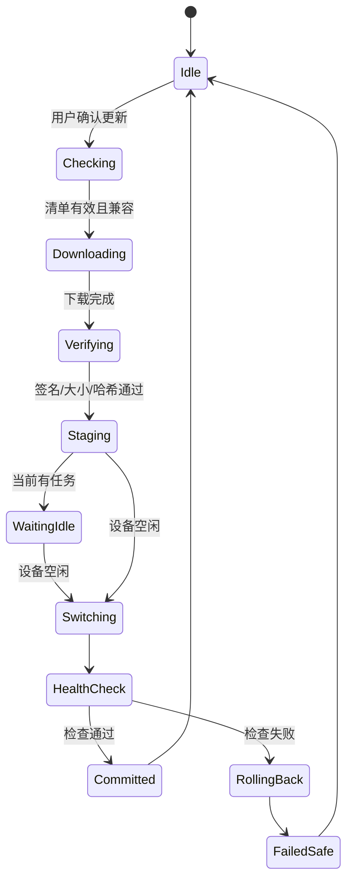

# 更新与回滚

## 当前实现边界（2026-09-12）

`internal/store` 将各组件 current/previous **逻辑指针**、当前事务、最近事务结果及通道最高 sequence 一起写入 `transactions/state.json`，没有独立的 current/previous 符号链接。这样一次原子替换覆盖整个版本选择状态，避免两指针不同步。适配器必须通过 Store 读取版本目录。

仅 Linux 目标实现目录 fsync；Windows 本地测试不承诺断电持久性。Linux/ARM64 已能交叉编译，实机断电/磁盘故障仍待验收。版本目录暂不自动清理，保留旧目录不会自动产生数据迁移/备份能力。

恢复行为：下载/校验/暂存阶段保留事务供安装器续接；切换/健康检查阶段重新打开 Store 时恢复原逻辑指针；状态 JSON 损坏则拒绝启动更新，不能重置为首次安装。新 daemon 必须先打开并恢复 Store，再启动任何 MAA worker。

下载器只接受已授权清单里的 HTTPS 地址并校验完整文件。项目 `tar.gz` 策略拒绝链接和特殊文件；独立 rootfs `tar.gz` 策略允许受限链接，拒绝任何 link 之下的归档条目，因此真实配方必须归一化 merged-usr 路径。原始 manager 二进制可暂存；ZIP/tar.zst 不支持。所有暂存父目录必须由调用方保持 root 私有。

控制器已有项目更新事务及固定 API，先下载/暂存，再等任务锁，最后切换与健康检查；原 WebUI 已有设置扩展。CLI 尚无真实运行驱动，模块默认恢复模式，安装/更新/回退执行不会开放。manager 自更新、rootfs 初始化、运行调度和完整救援仍未接通；现有单机 runner 的更新失败停跑策略未修改。下文是完整产品目标，不代表预览版已提供每项功能。

## 分层版本

后台必须分别显示并管理：

| 层 | 默认策略 | 更新来源 |
| --- | --- | --- |
| Root模块 | 仅提醒，按Root管理器流程安装 | 项目Release |
| `maa-managerd` | 稳定通道自动下载，空闲时切换 | 项目Release |
| 项目脚本/WebUI | 稳定通道，健康检查后切换 | 项目Release |
| Debian rootfs | 默认不原地大版本升级 | 经验证的rootfs产物 |
| maa-cli | 仅在兼容规则允许时更新 | 官方自更新机制 |
| MaaCore | 默认stable，空闲时更新 | `maa update stable` |
| 游戏资源 | 可高频更新，保留最后可用版本 | MAA官方资源链 |

Beta通道必须由用户主动开启，不继承当前单机部署的Beta默认值。

## 安装事务

事务必须写入 `/data/local/maa-platform/transactions/`，至少记录事务ID、旧版、新版、阶段、候选文件哈希、开始时间、最后更新时间和回滚结果。设备重启后根据记录继续下载、恢复旧版或完成清理，不能猜测状态。

设备还必须按stable/beta通道保存已接受的最高签名清单`sequence`。远端序号低于本地记录时视为回放或发布错误，拒绝更新；相同序号只有在原始清单哈希完全一致时才允许幂等读取。

## 切换规则

- 新版本先解压到新的不可变目录。
- 用户数据迁移先创建快照；迁移失败不切换程序。
- 切换使用原子指针更新，不覆盖当前目录。
- `previous`始终指向切换前的可运行版本。
- 健康检查通过后才清理更老版本；至少保留一个上一版。
- 运行中的MAA任务禁止切换后台程序、项目脚本、maa-cli或MaaCore。

## 健康检查

项目包更新后的最低检查：

1. 后台进程仍存活并能返回版本和事务状态。
2. WebUI静态入口可读取。
3. Debian chroot可以执行只读版本命令。
4. `maa version`可以返回maa-cli和MaaCore版本。
5. 配置文件可以解析，用户数据目录仍存在。
6. 不启动游戏、不运行完整日常任务。

涉及启动链的候选版本后续还需用户主动执行StartUp-only验收，不能用后台存活代替真实任务验证。

## 上游跟随策略

- 资源更新与程序更新分离，资源失败继续使用最后可用副本。
- MaaCore stable发布后先进入测试通道；通过项目回归后再允许稳定用户自动更新。
- maa-cli自更新前先检查项目清单声明的允许版本范围。
- 如果上游版本超出兼容范围，WebUI显示“发现上游新版本，等待本项目适配”，不能强行更新。
- 自有项目版本可以提升兼容范围，但不能偷偷改变用户选择的stable/beta通道。

## 救援

Root模块内保留不依赖Debian和项目包的最小恢复能力：

- 查看当前/上一版本。
- 停止后台和MAA任务入口。
- 回退到上一版。
- 清除未完成的候选下载。
- 导出最近事务和后台日志。

救援操作不能包含“删除全部数据”。彻底清理必须是独立、高风险、二次确认流程。
